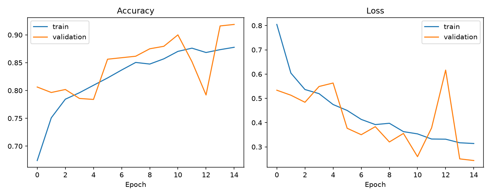
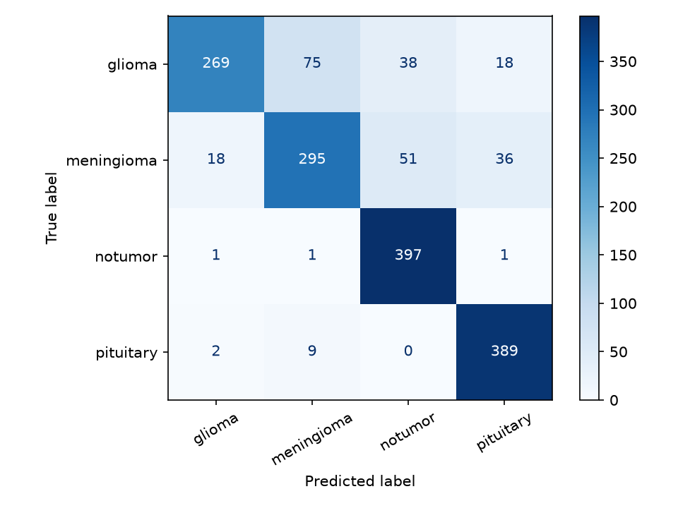
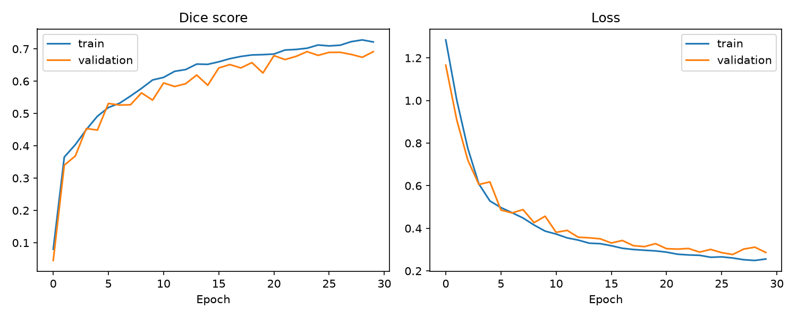
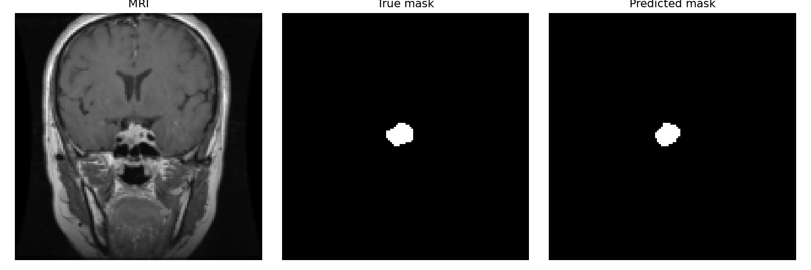
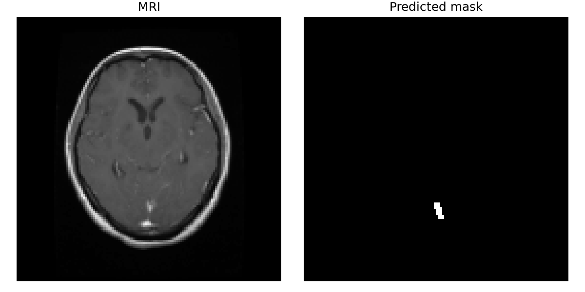

# Brain Tumor MRI Analysis with PyTorch

This is a learning project in which I built two deep learning models for brain MRI images using PyTorch:

1. **Classification:** a convolutional neural network (CNN) that sorts an MRI slice into one of four classes: glioma, meningioma, pituitary tumor, or no tumor.
2. **Segmentation:** a U-Net that marks the area of the tumor in an MRI slice.

> **Note:** This project is for educational purposes only. It is not a medical tool and must not be used for diagnosis.

## Results

| Task | Model | Metric | Result |
|---|---|---|---|
| Classification | CNN | Test accuracy | 84.38% |
| Segmentation | U-Net | Best validation Dice score | 0.692 |

### Classification

The model was trained for 15 epochs. The plots below show the training curves and the confusion matrix on the test set.




<!-- TODO: paste the classification report here -->

### Segmentation

The U-Net was trained for 30 epochs. The Dice score measures how much the predicted tumor area overlaps with the true one (1.0 is a perfect match).



| Good example | Failure case |
|---|---|
|  |  |

The results vary from slice to slice. Larger, well-defined tumors are segmented well, with some slices reaching a Dice score above 0.9. Very small tumors are often missed. For example, one tumor covered only 0.29% of its slice and received a score of 0.0, because shrinking the image to 128x128 pixels leaves very few tumor pixels.

## Datasets

The datasets are not included in this repository. They can be downloaded from the sources below. Please check each source for its license.

- **Classification:** [Brain Tumor MRI Dataset (Kaggle)](https://www.kaggle.com/datasets/masoudnickparvar/brain-tumor-mri-dataset). It contains four classes and is split into `Training` and `Testing` folders. I used 4,480 images for training, 1,120 for validation, and 1,600 for testing.
- **Segmentation:** [SciDB Brain Tumor Dataset](https://www.scidb.cn/en/detail?dataSetId=faa44e0a12da4c11aeee91cc3c8ac11e). It contains 3,064 MRI slices with matching tumor masks (1,426 glioma, 708 meningioma, 930 pituitary). I used 2,452 for training and 612 for validation.

## Project Structure

```
CNN/
├── config.py              # settings (paths, image size, epochs, etc.)
├── Classification/
│   ├── dataset.py         # loads and prepares the images
│   ├── model.py           # the CNN
│   ├── train.py           # training
│   ├── evaluate.py        # report and confusion matrix
│   └── predict.py         # classify a single image
├── Segmentation/
│   ├── seg_dataset.py     # loads images with their masks
│   ├── unet.py            # the U-Net, loss and metrics
│   ├── seg_train.py       # training
│   └── predict_mask.py    # predict and plot a mask
├── Results/               # plots and example images
├── Models/                # saved model weights (not on GitHub)
├── dataset/               # classification data (not on GitHub)
├── seg_dataset/           # segmentation data (not on GitHub)
└── requirements.txt
```

## How the Models Work

**Classification CNN.** The input is a 128x128 grayscale image. It passes through three convolution blocks (convolution, batch normalization, ReLU, max pooling), followed by two fully connected layers that output a score for each of the four classes. The training images are randomly flipped and rotated slightly to reduce overfitting. The weights with the best validation accuracy are saved, and the test set is used only once at the end.

**Segmentation U-Net.** The encoder shrinks the image to find what is in it, and the decoder enlarges it again to find where it is. Skip connections pass fine detail from the encoder to the decoder. The output is a tumor probability for every pixel. The loss combines binary cross-entropy and Dice loss, because the tumor covers only a small part of each image.

## Setup

Python 3.12 is recommended.

```bash
python -m venv venv
venv\Scripts\activate        # Windows
# source venv/bin/activate   # macOS / Linux
pip install -r requirements.txt
```

Then download the datasets and place them in the folders shown in the project structure.

## Usage

Run all commands from the project root folder.

**Classification**

```bash
python -m Classification.train
python -m Classification.evaluate
python -m Classification.predict
python -m Classification.predict "path/to/image.jpg"
```

**Segmentation**

```bash
python -m Segmentation.seg_train
python -m Segmentation.predict_mask
python -m Segmentation.predict_mask "path/to/image.png"
```

Settings such as image size, number of epochs, and batch size can be changed in `config.py`.

## Limitations

- In the segmentation data, slices from the same patient may appear in both the training and validation sets. This can make the Dice score look better than it would be on new patients.
- Every image in the segmentation dataset contains a tumor, so the model has not learned to recognize a scan without one.
- Small tumors are often missed at 128x128 resolution.
- The Kaggle classification dataset is known to contain near-duplicate images, so the accuracy may be higher than real-world performance.
- Both models were trained on a CPU for a limited number of epochs and were not extensively tuned.

## Possible Next Steps

- Train the U-Net at a higher resolution and for more epochs.
- Split the segmentation data by patient instead of randomly.
- Try transfer learning with a pretrained network for classification.
- Combine both models: classify the scan first, then segment it if a tumor is found.

## Built With

Python, PyTorch, torchvision, scikit-learn, matplotlib, Pillow, NumPy